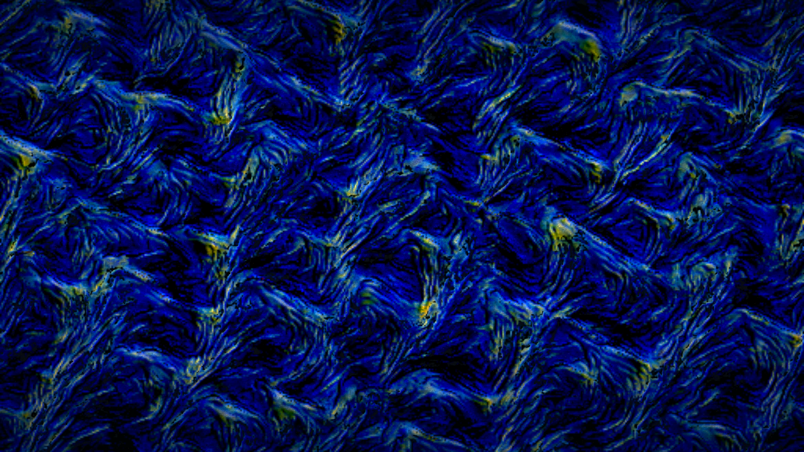

# 永不落定的星空 / A Sky That Never Settles

> 一片会生长、会受伤、会自愈、永不落定的《星空》式天空。  
> 由作者亲手训练的 **5,856 参数** texture NCA 驱动，全程在浏览器本地运行。

**在线作品：[https://wangcheng726.github.io/nca4plot/](https://wangcheng726.github.io/nca4plot/)**（2026-11-19 已通过 WebGPU / WASM 公网验收）



## 作品一句话

观众拖拽并撕开天空；被擦除的不是一层贴图，而是神经细胞自动机的真实 12 通道状态。松手后，残余细胞依据同一套局部规则重新协商边界、长出旋涡，继续流动。没有目标图可回退，也没有最终帧。

艺术观念是：**星空不是状态，而是过程。**

## 操作

- **拖拽 / 触摸并拖动**：擦除天空，制造裂口。
- **松手**：让伤口从边缘重新织合。
- **暂停 / 继续**：观察某个瞬间，或让流动继续；也可按空格。
- **重新生长**：把状态清零，从一颗零种子重新开始。
- **质感**：切换 `128 / 256 / 512` 三档模拟分辨率。
- **作品说明**：阅读艺术观念、科学边界与技术信息。
- **全屏**：进入无干扰观看。

初次打开会下载 ONNX Runtime Web 的相应后端文件，请预留约 30–40 MB 流量。支持 WebGPU 的浏览器优先使用 GPU；否则自动回退到 WASM。

## 技术与科学

### 一个小模型，而不是一张会动的图

模型严格采用 Distill / Google Research 的 texture NCA 路线，核心配置如下：

| 项目 | 配置 |
| --- | --- |
| 参数 | **5,856** 个可训练参数 |
| 状态 | 12 通道，前 3 通道为 RGB，后 9 通道为隐藏物质 |
| 感知 | identity / Sobel X / Sobel Y / Laplacian，四固定核，circular padding |
| 更新 | `Conv2d(48→96, 1×1)` + ReLU → `Conv2d(96→12, 1×1, bias=False)`，输出层零初始化 |
| 随机性 | 每步约 50% 细胞异步更新；训练时随机步长 `32–95` |
| 生长 | 从全零 128px 种子开始，不使用目标图作为 Web 端输入 |
| 损失 | VGG16 层 `[1, 6, 11, 18, 25]` + sliced optimal transport + overflow loss |

`pool` 中每 8 步把一个样本重播种为零状态。训练因此同时见到“从零生长”和“成熟纹理继续漂移”的状态。网页端不加载 exemplar：擦除后的重组完全由局部规则完成。

### 为什么擦除后能自愈

NCA 的每个细胞只读取近邻，却通过反复迭代形成全局旋涡。擦除把一块区域的所有通道清零，相当于抹去局部记忆；周围仍保有纹理状态的细胞继续更新，边界上的差异会驱动新的笔触向内生长。这里没有一个“修复模块”，生长与修复是同一个动力学过程的两种观察方式。

### 关于湍流，保持诚实

《星空》的旋涡常被读作湍流的视觉直觉。NCA 的“局部规则 → 全局自组织”与湍流的“局部作用 → 涡旋级联”构成一种结构上的同构，这也是本作把科学与审美视为同一事件的方式。

但关于《星空》亮度谱符合 Kolmogorov `−5/3` 律的 2024 年测量，2025 年已有同行评论，相关解释仍有争议。**本作借用的是“局部生成全局”的审美同构，不主张作品证明了物理定律。**

## 环境与复现

### 已验证环境

- Windows 11
- NVIDIA RTX 5070 Ti 16 GB（Blackwell `sm_120`）
- NVIDIA 驱动支持 CUDA 12.8+
- Python 3.12
- PyTorch `2.9.1+cu128`
- CUDA 12.8
- `uv` 管理依赖

Blackwell 显卡需要较新的 PyTorch/CUDA。若 `torch.cuda.is_available()` 为 `False`，先检查驱动与 PyTorch 的 CUDA 版本，而不是继续训练。

### 安装与 GPU 自检

```powershell
uv sync
uv run python -c "import torch; print(torch.__version__, torch.version.cuda, torch.cuda.is_available()); print(torch.cuda.get_device_name(0) if torch.cuda.is_available() else 'NO GPU')"
```

本机正式训练输出为 `2.9.1 12.8 True` 与 `NVIDIA GeForce RTX 5070 Ti`。

### 1. 准备《星空》天空 exemplar

源图已随仓库提供，来自 Wikimedia Commons / Google Art Project 的公有领域二维作品扫描。裁剪框避开月亮、柏树、村庄与山丘：

```powershell
uv run python -m nca4plot.prepare_exemplar --candidate A-core-swirl
```

输出：

- `data/exemplar_128.png`：实际训练用 128×128 天空局部
- `data/exemplar_metadata.json`：源图、裁剪框、SHA256 和许可信息
- `media/exemplar_candidates.jpg`：三个候选裁剪对比

### 2. 训练

```powershell
uv run python -m nca4plot.train --steps 5000 --out checkpoints/nca_starry.pt
```

正式训练参数：

- `pool=256`，`batch=4`，`train_size=128`
- 每步随机 `step_n ∈ [32, 96)` 反传
- 每 8 步将一个零种子写回 pool
- Adam `lr=1e-3`；MultiStepLR milestones `[1000, 2000]`，gamma `0.3`
- 梯度范数归一化
- 5000 steps，RTX 5070 Ti 实测约 **394.6 秒**，峰值 reserved 显存约 **4.37 GB**

训练日志和采样图位于 `checkpoints/training_log.jsonl`、`checkpoints/samples/`。

如需从断点恢复：

```powershell
uv run python -m nca4plot.train --steps 5000 --resume-state checkpoints/internal/last_state.pt
```

### 3. 导出网页模型

```powershell
uv run python -m nca4plot.export_onnx --checkpoint checkpoints/nca_starry.pt --sizes 128 256 512
```

导出器生成：

- `checkpoints/nca_starry_128.onnx`（每次推理 4 步）
- `checkpoints/nca_starry_256.onnx`（每次推理 4 步）
- `checkpoints/nca_starry_512.onnx`（每次推理 2 步，控制 GPU 单次负载）
- `checkpoints/nca_starry_model.pt`（仅权重的可移植 checkpoint）
- `checkpoints/nca_starry_weights.json`
- `checkpoints/export_report.json`（SHA256 与 PyTorch/ONNX 误差）
- `web/models/` 下的同名 ONNX 文件

已验证 PyTorch 与 ONNX Runtime 最大绝对误差：128 为 `5.96e-8`，256 为 `8.94e-8`，512 为 `4.47e-8`。

### 4. 本地运行网页

```powershell
uv run python -m http.server 8000 -d web
```

打开 <http://localhost:8000/>。必须通过 HTTP 服务访问；直接双击 `index.html` 可能因 ES modules、WASM 路径和跨域策略而失败。

### 5. 生成展示媒体

```powershell
uv run python scripts/capture_web.py --quality 512 --duration 17
```

脚本会启动本地服务器、用本机 Chrome 捕获真实 WebGPU 画面，并生成 MP4、GIF、海报、过程图和手机布局截图。需要安装 Chrome；媒体编码使用项目 dev 依赖中的 `imageio[ffmpeg]`。

## 交付物索引

| 交付物 | 位置 |
| --- | --- |
| 可分享网页源码 | `web/` |
| 训练代码 | `src/nca4plot/` |
| 正式 checkpoint | `checkpoints/nca_starry.pt` |
| 可移植权重 | `checkpoints/nca_starry_model.pt` |
| JSON 权重 | `checkpoints/nca_starry_weights.json` |
| 网页 ONNX 模型 | `web/models/*.onnx` |
| 训练日志与采样 | `checkpoints/training_log.jsonl`、`checkpoints/samples/` |
| 作品说明 | [`docs/artwork_statement.md`](docs/artwork_statement.md) |
| 展示视频 | [`media/nca4plot_demo.mp4`](media/nca4plot_demo.mp4) |
| GIF | [`media/nca4plot_demo.gif`](media/nca4plot_demo.gif) |
| 过程图 | [`media/process_contact_sheet.jpg`](media/process_contact_sheet.jpg) |
| 高清静帧 | `media/poster_nca4plot.png`、`media/poster_sky_1920x1080.png` |
| 部署工作流 | `.github/workflows/pages.yml` |

### 模型哈希

```text
nca_starry.pt
0df19d486b18fc10db69f909060ecc38dfb4eda8701ab0a51c32f29ea5434a1e

nca_starry_model.pt
57bbb1f55f1028b76e202df1ef5991b987116df23ae410cf710fa5e19767c3d1

nca_starry_weights.json
40d7314d5b3ad064a1c2118bf7e8c6620e25d2326b50eb06cf46ff620b305abc
```

## 部署

仓库包含 GitHub Pages workflow。推送到 `main` 后，Actions 会部署 `web/` 目录；也可在 GitHub Actions 页面手动触发 `workflow_dispatch`。

若首次启用 Pages，在仓库的 **Settings → Pages → Build and deployment** 中选择 **GitHub Actions**。工作流需要 `pages: write` 和 `id-token: write` 权限，配置已写在 workflow 中。

本次交付已部署并通过公网验收：

<https://wangcheng726.github.io/nca4plot/>

2026-11-19 实测首页、三个 ONNX 模型和 ORT 资源均返回 200；Chromium 下 WebGPU 主路径与 WASM 回退各完成一次运行，并检查了持续步进、暂停、鼠标擦除自愈、512 档切换和 390×844 移动端布局。

## 测试

```powershell
uv run pytest
```

覆盖内容：

- 参数量精确为 5,856
- circular padding、1×1 输入与非方形输入
- 零种子与 12 通道擦除
- 交付 checkpoint 可擦除后继续推理
- 三档 ONNX 存在、元数据完整且与网页模型逐字节一致
- 256 图 PyTorch/ONNX 数值对齐
- 真实浏览器 WebGPU/WASM 启动、流动、暂停、擦除、自愈、复位、切换画质
- 390×844 手机布局无横向溢出

浏览器测试需要本机 Chrome；未安装时相关测试会明确跳过。

## 目录结构

```text
nca4plot/
├─ data/                 # 公有领域源图、天空裁剪、exemplar metadata
├─ src/nca4plot/         # 模型、损失、训练、rollout、ONNX 导出
├─ checkpoints/          # 正式权重、日志、训练采样和导出报告
├─ web/                  # 纯静态交互网页、ONNX Runtime Web、模型资源
├─ media/                # 海报、GIF、MP4、过程图、手机截图
├─ docs/                 # 作品说明
├─ scripts/capture_web.py
├─ tests/
└─ .github/workflows/pages.yml
```

## 已知限制

- 这是**纯天空纹理作品**，不包含月亮、柏树、村庄或完整《星空》构图。加入固定构图应走 texture grafting 或区域混合，不属于本次已验收版本。
- WebGPU 不可用时会回退到 WASM；512 档在移动端或 CPU 后端可能明显变慢。
- 画面是实时随机动力学，无法逐像素复现某一历史帧；模型权重、种子逻辑与训练过程可复现。
- 笔触是面向屏幕的实时渲染与后处理，不是物理颜料，也没有实体输出。

## 文献与先例

- Mordvintsev et al., [Growing Neural Cellular Automata](https://distill.pub/2020/growing-ca/), Distill, 2020.
- Mordvintsev et al., [Self-Organising Textures](https://distill.pub/selforg/2021/textures/), Distill, 2021.
- Google Research, [texture_nca_pytorch.ipynb](https://github.com/google-research/self-organising-systems/blob/master/notebooks/texture_nca_pytorch.ipynb).
- Ma, Cheng, Huang, Schmitt, Lin & Huang, “Hidden turbulence in van Gogh’s *The Starry Night*,” *Physics of Fluids* 36(9), 095140, 2024. [arXiv:2310.03415](https://arxiv.org/abs/2310.03415), DOI `10.1063/5.0213627`.
- Gad-el-Hak, Bourgault, Riley & Chavanne, “Comment on ‘Hidden turbulence in van Gogh’s *The Starry Night*’,” *Physics of Fluids* 37(12), 129101, 2025. DOI `10.1063/5.0306945`.
- Aragón et al., “Turbulent Luminance in Impassioned van Gogh Paintings,” *Journal of Mathematical Imaging and Vision* 30(3), 275–283, 2008. [arXiv:physics/0606246](https://arxiv.org/abs/physics/0606246).
- Znah, [Hexells](https://znah.net/hexells/).
- Sakana AI, [Digital Ecosystem](https://pub.sakana.ai/digital-ecosystem/).
- DyNCA, [Dynamic Neural Cellular Automata](https://dynca.github.io/).
- [cells2pixels](https://arxiv.org/abs/2506.22899), 2025（仅作为后续高分辨率显示方向的参考，不在本版实现内）。

## 许可与致谢

- 本项目原创代码：MIT，见 [`LICENSE`](LICENSE)。
- 训练权重：CC BY 4.0。
- Van Gogh, *The Starry Night* (1889)：公有领域二维作品，来源与扫描信息见 `data/exemplar_metadata.json`。
- 训练路线来自 Google Research `self-organising-systems`，上游代码为 Apache License 2.0。
- ONNX Runtime Web 遵循其自身许可。

完整第三方许可见 [`LICENSES.md`](LICENSES.md)。

---

作者：Wang Cheng · 2026  
艺术与科学课程作品